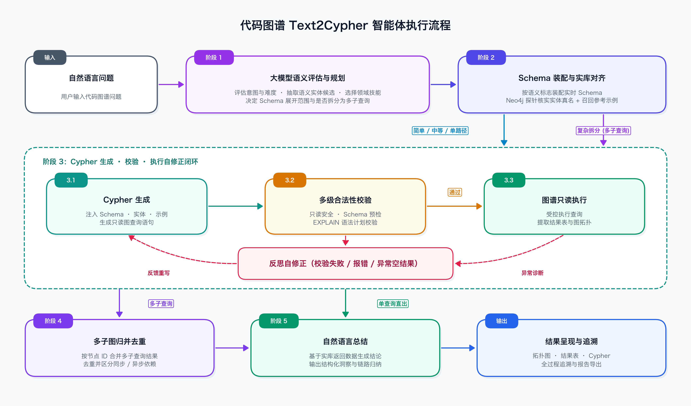
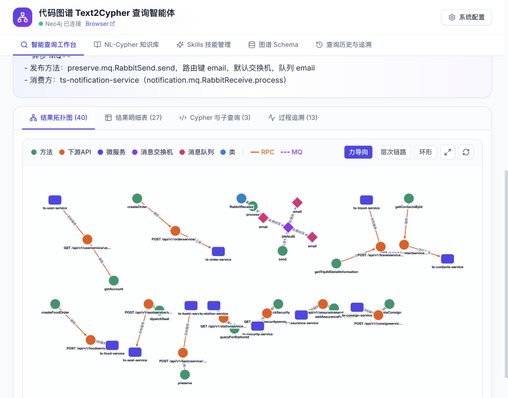
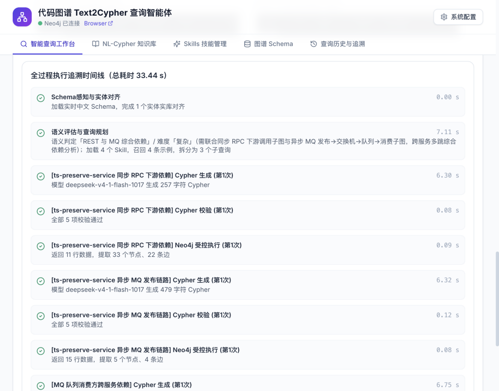
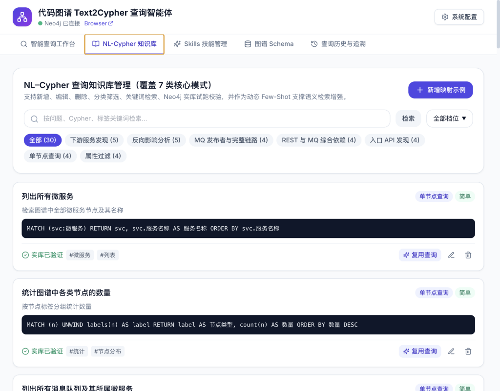
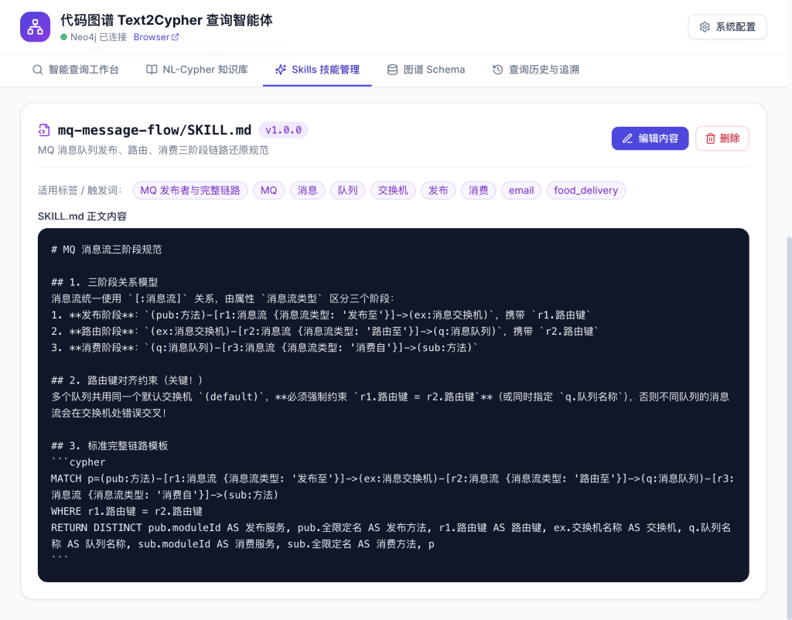

# 面向代码图谱的 Text2Cypher 查询智能体

面向微服务代码图谱（Neo4j）的自然语言查询智能体，支持将中文自然语言问题转换为严格受控的只读 Cypher，完成跨服务调用链、反向影响分析、MQ 三阶段消息流及 RPC + MQ 综合依赖分析，并输出交互式拓扑图、自然语言总结、全链路追溯与 Markdown 报告。

---

## 一、实现思路

传统单向开环 Text2Cypher 流水线在面对**多跳跨服务调用、异构通信（RPC + MQ）、口语化实体名称、错别字及执行报错/空结果**时非常脆弱。本系统参考近年 Text2Cypher / Text2SQL 前沿进展（如 Ozsoy 2025 `arXiv:2505.05118` *Enhancing Text2Cypher with Schema Filtering*、NAACL 2025 *CodexGraph* 及 CHESS 执行反馈范式），采用四项核心设计：

1. **大模型语义评估与统一规划（无关键词规则）**
   - 不使用低级关键词/字典判断难度或抽取实体。前置由大模型结合轻量图谱骨架一次性输出**意图分类、基于图遍历复杂度的难度等级与理由、Schema 按需展开标志、语义实体候选（含错别字纠错）、所需领域 Skills 及子查询拆解方案**。
2. **Enhanced Schema 感知 + 拼写容错实库对齐**
   - 启动时自动连接目标 Neo4j 抽取实时中文标签、23 种有向三元组、精选高价值属性与关键枚举值（自动剔除 0 节点空标签与 40+ 内部静态分析噪音字段）。
   - 生成 Cypher 前，定向将语义抽取出的实体候选在 Neo4j 中核实真名；若精确/包含匹配未命中，自动基于 `SequenceMatcher` 编辑相似度在实时实体词表中做**拼写容错匹配**。
3. **可编辑的知识库（Few-Shot RAG）与模块化领域技能（`SKILL.md`）**
   - 沉淀 30 组覆盖 7 类核心模式、经实库跑通验证的 NL–Cypher 黄金样本，按语义相似度 + 意图加权动态召回参考模板。
   - 将图谱中的非显式拓扑约束（如 `类/方法` 通过 `moduleId`/`serviceContexts` 关联微服务、MQ 多队列共用默认交换机必须约束 `r1.路由键 = r2.路由键`、多跳限深防环）封装为可版本化、可在线编辑热加载的 `SKILL.md` 单元，由大模型按需语义选用。
4. **三层安全护栏 + 最多 5 轮执行反馈自修正闭环**
   - 执行前完成 ① 非空/只读/写操作与危险 APOC 拦截 → ② 实时 Schema 标签/关系/属性预检 → ③ Neo4j 原生 `EXPLAIN` 语法与执行计划校验。
   - 校验拦截、运行报错或主查询异常 0 结果时，将诊断信息回传大模型反思重写（最多重试 5 轮）；复杂多子查询分别执行后按节点 `elementId` 去重归并子图，区分标注同步 RPC 与异步 MQ。

---

## 二、执行流程

系统执行分为 **5 个核心阶段**，后端通过 SSE 实时推送当前执行阶段与精确耗时（单位：`s`）：



1. **阶段 1 · 大模型语义评估与规划**：基于紧凑图谱骨架与 Skill 目录，一次 LLM 调用完成意图/难度评估、Schema 展开标志判定、实体抽取与纠错、Skill 选择及复杂查询拆解。
2. **阶段 2 · Schema 装配与实库对齐**：按语义标志装配 Enhanced Schema，通过 Neo4j 探针与编辑相似度容错核实实体真值，并从知识库召回 Top-K 相似已验证示例。
3. **阶段 3 · Cypher 生成 · 校验 · 执行自修正闭环**：注入 Schema、对齐实体、Skills 与示例生成 Cypher → 三层护栏校验 → Neo4j 只读受控执行；失败或异常空结果自动反思重试（最多 5 轮）。
4. **阶段 4 · 多子图归并去重**：复杂拆解模式下合并各子查询的节点、边与结果行，消除重复路径并标注同步 RPC / 异步 MQ。
5. **阶段 5 · 自然语言总结与持久化**：基于实库返回样本生成忠于事实的中文结论，完整 Trace 落盘 SQLite，支持历史回放与一键导出 Markdown 报告。

---

## 三、界面预览

### 1. 智能查询工作台与 RPC + MQ 混合拓扑图
支持实时阶段进度展示（单位：`s`）、自然语言总结、Cytoscape.js 交互拓扑图（按节点类型着色，橙色实线表示 RPC、紫色虚线表示 MQ，支持切换布局与点击查属性）及一键导出 Markdown 报告。



### 2. 全过程执行追溯（Trace）
完整记录实体对齐结果、加载的领域技能、三层护栏校验项、知识库召回示例及各阶段精确秒级耗时时间线。



### 3. NL–Cypher 查询知识库管理
内置 30 组覆盖 7 类核心查询模式的实库验证示例，支持分类筛选、关键词检索、新增/编辑/删除、Neo4j 实库一键试跑校验与复用查询。



### 4. Skills 领域技能查看与在线编辑
支持直接查看每个 `SKILL.md` 的完整 Markdown 规则正文、在线编辑保存并立即热加载至查询引擎，或新建自定义领域技能。



---

## 四、快速启动

### 1. 配置环境变量
系统严格限定仅使用 **DeepSeek / GLM / Kimi**。复制 `.env.example` 为 `.env` 并填入任意一家 API Key（或直接通过系统环境变量配置，也可在界面右上角「系统配置」中调整）：

```bash
cp .env.example .env
```

### 2. 构建前端并启动服务（单进程推荐）
构建前端静态资源至 `frontend/dist` 后，启动 FastAPI 即可访问完整图形化界面：

```bash
cd frontend && npm install && npm run build && cd ..
uv sync
uv run uvicorn backend.main:app --host 0.0.0.0 --port 8000
```

浏览器打开：`http://127.0.0.1:8000`

### 3. 前端开发模式（可选）
```bash
cd frontend
npm install
npm run dev
```

### 4. 验证脚本
```bash
# 验证 30 组 NL-Cypher 知识库条目在目标 Neo4j 中 100% 语法正确且结果非空
uv run python scripts/verify_kb.py

# 运行端到端 API、安全护栏、复杂查询与 Markdown 报告导出测试
uv run python scripts/test_e2e.py
```
